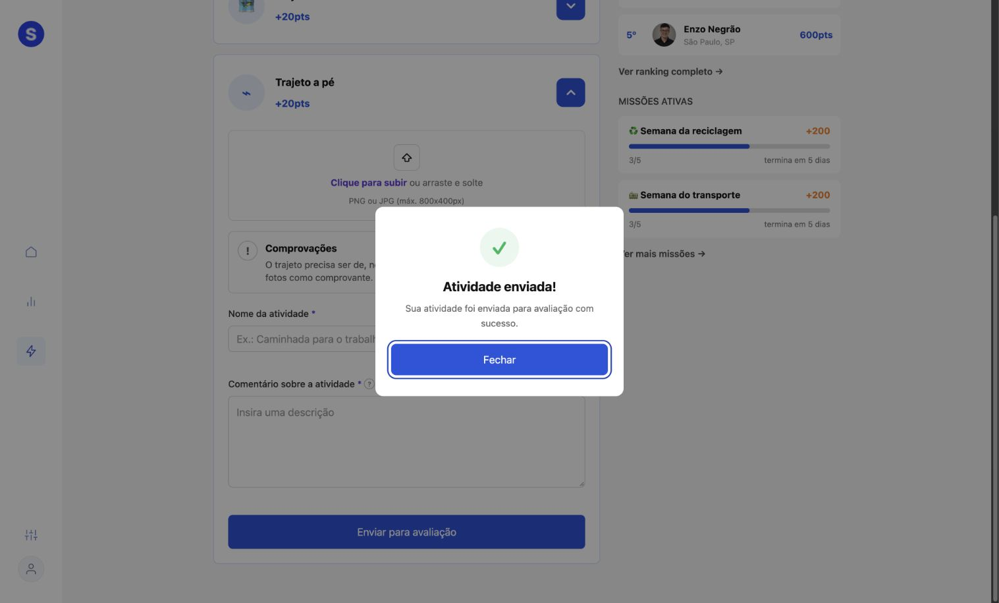

# Verificação manual do ModalSucesso

Execute `npm ci` e `npm run test:modal` dentro de `soul-move-app`.
Abra http://127.0.0.1:5181. Este cenário importa o componente real,
usa React StrictMode e não chama API, localStorage ou envio de atividades.

## Roteiro de regressão

1. Com Tab, alcance **Abrir modal de teste** e pressione Enter.
   O foco deve ir para **Fechar**, com contorno visível.
2. Pressione Tab e Shift+Tab repetidamente: o foco deve ficar no diálogo,
   sem alcançar o link de fundo.
3. Pressione Escape. O diálogo deve fechar e devolver o foco ao disparador.
4. Reabra e ative **Fechar**: deve ocorrer o mesmo retorno do foco.
5. Reabra e clique no texto interno: o diálogo deve continuar aberto.
6. Clique na área escurecida: deve fechar e devolver o foco ao disparador.
7. Enquanto aberto, a rolagem do documento deve ficar bloqueada. Ao fechar,
   o valor anterior de overflow deve ser restaurado.
8. Na árvore de acessibilidade, confira nome **Atividade enviada**, descrição
   correspondente ao parágrafo e semântica modal nativa (`dialog.showModal`).
9. Com redução de movimento habilitada, a abertura deve continuar sem
   escala/deslocamento. O botão deve ter transição desabilitada.

## Execução em 22/10/2026

Reproduzida a falha original: foco permanecia no botão externo ao abrir.
Após correção, passaram no Chromium do navegador integrado: foco inicial,
Tab, Shift+Tab, Escape, retorno de foco, fechamento por botão e fundo,
permanência ao clicar dentro, bloqueio/restauração da rolagem e associação
do título/descrição. O cenário deste diretório também foi executado na porta
5181, confirmando Tab, Shift+Tab, Escape e retorno ao disparador.

No Chrome, a aplicação clonada foi executada na porta 5180. Um formulário de
atividade foi preenchido com dados fictícios e um PNG de teste. O modal real
recebeu foco em Fechar, reteve Tab/Shift+Tab e devolveu o foco ao botão
Enviar para avaliação após Escape. A rolagem foi restaurada. Não houve API:
o comportamento existente creditou 20 pontos no localStorage exclusivo da
origem de teste (500 → 520). Essa concessão anterior à aprovação permanece
um problema separado de pontuação/integração; não foi alterada nesta correção.

Redução de movimento: conferida no código (animações de escala e deslocamento
removidas, transição do botão condicionada à preferência). Ainda não testada
com preferência do sistema alterada. Firefox, Safari e leitores de tela não
foram testados. Integração real de API e pontuação estão fora deste cenário.
